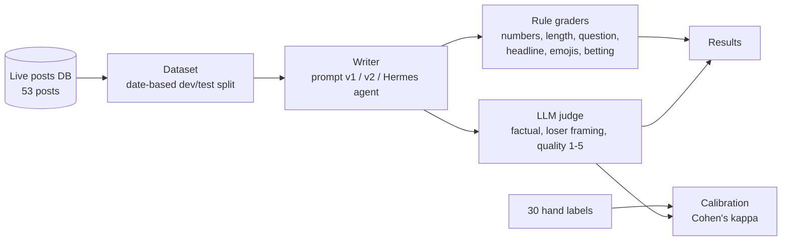

# boxscorebrief-evals

An evaluation harness for the AI that writes captions for [@boxscorebrief](https://instagram.com/boxscorebrief),
a live sports-by-the-numbers Instagram account. It measures caption quality with rule-based graders and a
calibrated LLM judge, then uses those measurements to improve the writer.

## Why
My Instagram account runs on AI-written captions, and honesty is the brand, so one invented stat could mislead thousands of followers. Eyeballing every caption doesn't scale, and my existing automatic checker was blocking accurate posts. I built this harness to measure caption accuracy and voice, then used the measurements to improve the writer.

## How it works


## Results

**1. The production number checker was mostly false alarms.**
| Checker | False alarms (of 30 labeled posts) |
|---|---|
| Original (v1) | 15 |
| Rebuilt (v2): ignores hashtags, allows odds derived from facts | **5** (−67%) |

There were no invented numbers in the labeled set, so the checker's recall is not yet tested (see Next steps).
False alarms led me to reject 3 posts I later graded as accurate.

**2. The LLM judge agrees with human labels at κ = 0.61.**
- First run: κ = 0.44. Reviewing the 9 disagreements showed the judge had caught **2 misread claims**
  (a wrong "biggest jump", a model adjustment described as a real scoring margin) that both the rule checker and I missed,
  and that 2 of my labels broke my own rubric. After adjudication: κ = 0.61, factual agreement 29/30.
- The judge also exposed a wrong human label (#41: a "35.7%" I thought was invented was in the facts as 0.357).
Neither my labels nor the judge is ground truth on its own; the disagreements between them are where errors surface.

**3. Eval-driven prompt fixes (16 test posts, same model, blind judge).**
| | Prompt v1 (production) | Prompt v2 |
|---|---|---|
| Captions framing our pick as a loser | 9/16 | **0/16** |
| Judge-flagged factual errors | 2/16 | **0/16** |
| Mean judge quality (1-5) | 3.38 | **4.81** |
| Writer input tokens | baseline | +5% |

I made three targeted changes, each fixing an error type found during labeling: replaced a prompt example that taught "our pick loses" framing, required "biggest riser" claims to be checked against every team, and explained that model factor amounts are prediction adjustments, not real stats.


**4. Hermes agent with self-check (16 test posts, same model and judge).**

| | Prompt v1 | Prompt v2 | Hermes agent + self-check |
|---|---|---|---|
| Mean judge quality (1-5) | 3.38 | **4.81** | **4.81** |
| Judge-flagged factual errors | 2/16 | **0/16** | **0/16** |
| Loser framing | 9/16 | **0/16** | 1/16 |
| Real rule violations | 2 | 2 | **0** |
| Input tokens per caption | ~2.4k | ~2.6k | ~105k (~40x) |

Measuring before adding an agent can save on cost. A targeted prompt fix gave the same quality gain at 1/40th of the tokens. The agent's only extra value was fixing mechanical rule misses, so I'd use escalation: one-shot first, and the agent only when a cheap check fails.


## Limitations
- Small data: 53 posts, 30 hand-labeled by one person, one sample per caption.
- Test-set leakage: three errors that motivated prompt v2 came from test-set posts. Validation on new posts is in progress.
- The judge is stricter than I am on invented reasoning (it scores 1 where I score 2–4).
- Remaining checker false alarms (counts like "14 games", ratios like "20 times") need meaning, not rules.
- An agent's workspace is part of its input. In my second run, leftover drafts from an earlier run were visible to the agent and it read 3 of them while saving. A clean comparison needed an empty drafts folder every run.

## Run it
```bash
python3 -m venv .venv && source .venv/bin/activate
pip install anthropic python-dotenv pytest
echo "ANTHROPIC_API_KEY=<your key>" > .env
python3 -m bbeval.dataset            # build data/cases.jsonl (needs the private posts DB)
python3 -m bbeval.compare_checkers   # checker v1 vs v2 against hand labels
python3 -m bbeval.calibrate          # judge vs hand labels, Cohen's kappa
python3 -m bbeval.experiment         # prompt v1 vs v2 on the test split
```

## Next Steps
- Validate prompt v2 on fresh posts via a daily Hermes job (removes the test-set leakage)
- Adversarial cases with planted fake stats to measure the checker's and judge's recall
- CI: run the rule-grader tests automatically on every push
